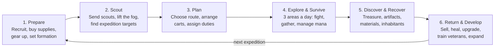

# Brave the Unknown — Game Design Document

Last updated: 2026-11-15 · Living version: [Claude doc](https://claude.ai/artifact/U1pjuhGTG3brJvLsnX6esq)

## 1. Game overview

Brave the Unknown is a single-player expedition-management RPG: the player funds, equips and directs an expedition, while hired adventurers fight on their own in auto-resolved, turn-based battles.

| Field | Value |
| --- | --- |
| Title | Brave the Unknown |
| Genre | RPG, turn-based auto battler, strategy / management |
| Platform | PC |
| Target audience | Turn-based RPG and management-game players |
| Game mode | Single-player |
| Perspective | 2D side view |
| Setting | Post-apocalyptic medieval fantasy |

**Summary.** The player buys, sells and recruits to run an expedition into an unknown world. The player only provides support — logistics, formation, routes, supplies — and lets the adventurers do the fighting.

## 2. Unique selling points

The hook is that you are the expedition's backer, not its hero: you win by preparing well, then watching your people carry it out.

1. **Design your expedition.** Place carts, station parties and assign equipment to protect the caravan.
2. **Recruit a living roster.** Adventurers have distinct faces, classes and traits; you form them into parties and send them to fight for your cause.
3. **Grow veterans.** Adventurers gain experience and advance from 6 base classes: Soldier, Archer, Cleric, Mage, Warrior, Rogue.
4. **Two views, one role.** Swap between the Overseer view (logistics, map, scouting) and the Combat view (zoom in on one fight or watch all fights at once).
5. **Explore the unknown gradually.** Send scouts and pick expedition targets to slowly reveal a randomly generated world.

## 3. Concept & story

The world collapsed in the Great Magic War, and survivors now hide behind magic barriers while the mana waste outside slowly dissipates.

**The mana waste.** Leftover mana reshaped the terrain and floods it with life force. It also drives creatures into frenzy, and a human who absorbs too much mana can explode. Cities therefore live in isolation, each sealed behind its own barrier.

**The protagonist.** A wealthy merchant sees opportunity where others see ruin. He sells his entire fortune to fund a great expedition: hiring adventurers, preparing equipment and braving the unknown.

**The goal.** Find forgotten treasure and restore order to the world. As the story progresses, the player learns that 10 other cities still survive. Exploring and reconnecting all of them — and becoming the wealthiest man in the world — is the long-term objective.

**Tone.** Medieval fantasy with a hopeful, mercantile edge: danger is real, but every ruin is also a business opportunity.

## 4. Core gameplay loop

Each expedition is a six-phase loop: prepare in the city, scout and plan, survive the field, then return richer and stronger for the next run.

1. **Prepare the expedition.** Recruit adventurers, purchase supplies, organize equipment and build the expedition formation.
2. **Scout the unknown.** Send scouts, reveal unexplored terrain and discover potential expedition targets.
3. **Plan the expedition.** Choose routes, arrange carts, position adventurers and assign their duties.
4. **Explore & survive.** Travel through a Region area by area, encounter enemies, fight, collect resources and manage mana contamination (details in section 6).
5. **Discover & recover.** Find forgotten treasures, ancient technology, magical artifacts, valuable materials or other inhabitants.
6. **Return & develop.** Sell treasures, treat survivors, improve equipment, develop veterans and expand the expedition.

## 5. Adventurers & combat

Adventurers fight automatically using Fire Emblem: The Sacred Stones-style stats and formulas; the player's influence comes before the fight (recruitment, gear, formation, duties), not during it. Items marked *(proposed)* are starting points to tune, not decisions.

### Adventurers

Each recruit has a face, a class, one or more traits, stats and a level. Survivors become veterans and can advance to a stronger class.

| Base class | Role *(proposed)* | Main stats *(proposed)* | Damage type |
| --- | --- | --- | --- |
| Soldier | Front-line tank, guards carts | HP, Str, Def | Physical |
| Archer | Back-line ranged damage | Skl, Str, Spd | Physical |
| Cleric | Healing and support | Mag, Res, Lck | Magic |
| Mage | Back-line magic damage | Mag, Skl, Res | Magic |
| Warrior | Front-line burst damage | Str, HP, Spd | Physical |
| Rogue | Fast flanker, crits, ambush counter | Spd, Skl, Lck | Physical |

### Stats

| Stat | Effect |
| --- | --- |
| HP | Hit points; 0 = knocked out (death rules still open) |
| Str | Physical attack power |
| Mag | Magic attack power; also healing amount |
| Skl | Hit chance and critical chance |
| Spd | Attack speed: avoid and double attacks |
| Lck | Small bonus to hit and avoid; reduces enemy crits |
| Def | Reduces physical damage |
| Res | Reduces magic damage; may also resist mana contamination *(proposed)* |
| Con | Offsets weapon weight |

### Combat formulas *(proposed, adapted from FE GBA)*

- **Attack** = Str or Mag + weapon Might
- **Damage** = Attack − target Def (physical) or Res (magic), minimum 0
- **Attack speed (AS)** = Spd − max(0, weapon Weight − Con)
- **Double attack** when own AS ≥ enemy AS + 4
- **Hit** = weapon Hit + Skl × 2 + Lck ÷ 2
- **Avoid** = AS × 2 + Lck + terrain bonus
- **Hit chance** = Hit − enemy Avoid, clamped to 0–100%
- **Crit** = weapon Crit + Skl ÷ 2; **crit chance** = Crit − enemy Lck; a crit deals 3× damage

### Turn order *(proposed)*

Battles run in rounds on the 2D side view. Each round, units act in order of AS. Each unit picks a target by its class AI (front line attacks nearest, back line targets lowest HP or highest threat, Cleric heals lowest HP ally). Fights end when one side is defeated or retreats.

## 6. Expedition & travel

An expedition crosses a Region of 9–15 areas at 3 areas per day (4 if the party skips resting), and terrain, ambushes and mana decide what each day costs.

### Movement

- Each day the expedition travels **3 areas**, or **4 if it skips resting** (resting trade-off to define: e.g. stamina or morale loss).
- Entering an area can trigger an encounter, a battle, resource collection or an event.
- Finishing a Region grants a **big reward**: an artifact, magic item, rare materials or new recruits.

### Terrain effects

| Terrain | Travel effect | Other effects |
| --- | --- | --- |
| Plain | Normal (3/day) | Common near the starting city |
| Forest | Normal (3/day) | Common near the starting city |
| Snow | Slow: 2 areas/day | Affects battle; found further north |
| Desert | Normal | Needs extra water or the party becomes dehydrated |
| Hill / Mountain | To define | Found further north |
| Swamp | To define | To define |
| Cave | To define | To define |

### Mana waste

Some areas are saturated with mana. Monsters there are stronger and rewards are bigger, but lingering too long builds **mana contamination** that can end in a mana explosion. The player manages how long to stay and when to pull out.

### Ambushes & formation

- Enemies may ambush and attack the carts while the expedition is moving, so cart guards and station assignments matter.
- On arriving at a new area, the player sometimes needs to rearrange troops before the fight begins.

## 7. World & level design

The world map is randomly generated under fog of war, starting gentle around the home city and getting harsher with distance.

### World map

- Generated randomly each run, fully covered by fog of war at start.
- Scouting and expeditions reveal hints and then terrain.
- Difficulty follows geography: plains and forest surround the city; travelling north leads to snow and mountains.
- 10 other surviving cities are hidden somewhere on the map.

### Map icons revealed by scouting

| Type | Examples |
| --- | --- |
| Terrain | Forest, plain, desert, snow, hill, swamp, cave |
| Points of interest | Iron Mine, Ruins, City, Hunting Ground, Herb Patch |

### City facilities

| Facility | What the player does there |
| --- | --- |
| Supply shop | Buy food, water and expedition consumables |
| Goods market | Trade goods, including goods other cities need once found |
| Equipment shop | Buy, sell and upgrade weapons and armor |
| Tavern | Hear news and rumours; raise morale (squad buff) |
| Guild | Recruit new adventurers |

### Discoveries

Expeditions can find forgotten treasures, ancient technology, magical artifacts, valuable materials and other inhabitants. Back in the city, the player sells treasure, treats survivors, improves equipment, develops veterans and expands the expedition.

## 8. UI/UX (in progress)

The player switches between two roles, each with its own view; the screen list will grow as development continues.

### Player views

- **Overseer view (management).** The player is the wealthy merchant: managing adventurers, supplies, equipment, logistics and exploration.
- **Combat view (adventure).** The player keeps the expedition alive and makes tactical calls when things go wrong. They can zoom in on one adventurer's fight or watch all fights at the same time.

### Screens and HUD

- [ ] Main menu
- [ ] Pause menu
- [ ] Health and stamina bars
- [ ] Inventory
- [ ] Quest log
- [ ] Skill menu
- [ ] World map
- [ ] Settings
- [ ] Expedition formation / cart layout editor *(proposed)*
- [ ] Roster and adventurer detail screen *(proposed)*
- [ ] City hub with facility screens *(proposed)*

## 9. Open questions

These decisions shape balancing and should be settled before prototyping combat and travel.

- [ ] **Permadeath?** Does an adventurer at 0 HP die, get injured, or retreat?
- [ ] **Class advancement.** What does each base class promote into, at what level or condition, and is there a branching choice?
- [ ] **Traits.** What traits exist (e.g. Brave, Greedy, Mana-sensitive), and are they positive, negative or both?
- [ ] **Weapon triangle.** Keep FE's sword/axe/lance and anima/light/dark triangles, or replace with something simpler?
- [ ] **Hit roll.** Use one random roll, or FE GBA's averaged two-roll "true hit"?
- [ ] **Formation rules.** How many rows and slots, and how do carts sit in the formation?
- [ ] **Skipping rest.** What exactly does it cost (stamina, morale, HP)?
- [ ] **Mana contamination.** How is it measured, what raises or lowers it, and what happens at the limit?
- [ ] **Economy.** Upkeep per adventurer, wages, food and water per day, cart capacity.
- [ ] **Scouts.** Are scouts adventurers, hired NPCs or an item? Can they be lost?
- [ ] **Failure state.** What happens when an expedition is wiped out or the merchant runs out of money?
- [ ] **Remaining terrain.** Effects of hill, swamp and cave.
